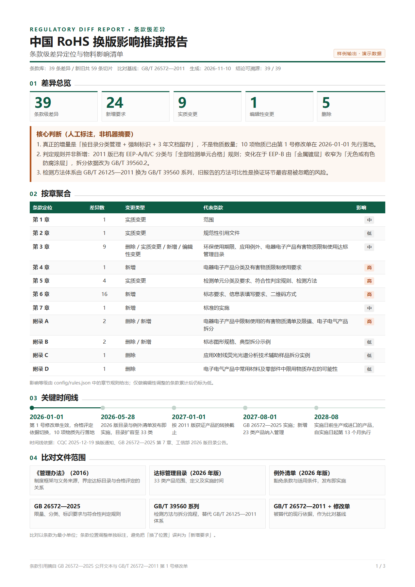
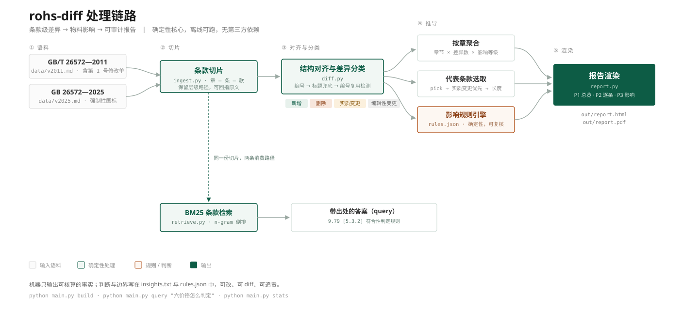

# rohs-diff

中国 RoHS 换版的**条款级差异推演**工具：把「人工逐条比对法规 + 逐个物料排查」，转成「条款级差异 + 物料影响清单」。

面向的不是"读得更快"，而是**结论可审计**——每条判断都能回指到条款号和原文片段。



## 3 分钟验证

```bash
cd rohs-diff
python main.py build
```

不用装依赖，不用配 API Key。跑通后应看到下面三行，**数字由 `data/*.md` 计算得出，不是写死的**，请逐个核对：

```
切片：旧版 17 条 / 新版 42 条
差异：39 条（新增 24 / 删除 5 / 实质变更 9 / 编辑性变更 1）
规则命中：7 组，明细取前 4 条
```

产物：`out/rohs-diff-report.pdf`（3 页 A4：差异总览 / 逐条对照 / 影响清单）、`out/rohs-diff-report.html`。

再验一条检索，确认结论可溯源：

```bash
python main.py query "六价铬怎么判定"
```

返回 `[5.3.2] 符合性判定规则` 及原文片段——**每条答案强制附带条款号**。

## 命令一览

| 命令 | 作用 |
|---|---|
| `python main.py build` | 生成报告（HTML + PDF） |
| `python main.py build --no-pdf` | 只出 HTML，适合无浏览器的环境 |
| `python main.py stats` | 查看语料规模与差异分布 |
| `python main.py query "<问题>"` | 条款级检索，返回结果与出处 |

无需第三方依赖，Python 3.10+ 即可。PDF 导出调用本机 Edge / Chrome，找不到时自动跳过，HTML 不受影响。


---

## 它在做什么



两份条款语料进入后先切成「章—条—款」，再做结构对齐与四类差异分类，随后分出三条推导路径（按章聚合、代表条款选取、影响规则引擎），最终渲染成三页 A4 报告。同一份切片另有一条检索路径，供 `query` 命令返回带条款号的答案。

| 模块 | 职责 |
|---|---|
| [src/ingest.py](src/ingest.py) | Markdown 语料 → 条款对象，保留 `path` 层级 |
| [src/diff.py](src/diff.py) | 对齐、分类、按章聚合 |
| [src/impact.py](src/impact.py) | 规则匹配、代表条款选取、证据缺口统计 |
| [src/retrieve.py](src/retrieve.py) | 字符 n-gram 倒排 + BM25 |
| [src/report.py](src/report.py) | 三页 A4 HTML 渲染 |
| [main.py](main.py) | CLI 编排与 PDF 导出 |
| [config/rules.json](config/rules.json) | 影响规则、时间线、边界声明（可热改） |

---

## 三个关键设计

### 1. 编号复用：不能只看编号对齐

2011 版「4 限量要求」与 2025 版「4 分类及要求」编号相同、语义无关。直接按编号配对会把"删除旧章 + 新增新章"误判成"一条改写"。

处理方式：编号命中后先比对标题相似度，低于 0.35 视为编号被复用，退回全局标题匹配；仍无匹配则拆成「删除 + 新增」。因此 2011 版第 4 章能正确对齐到 2025 版 5.1，被识别为**实质变更**。

### 2. 影响判定不走 LLM

条款 → 物料类别的映射由 `config/rules.json` 的确定性规则完成。原因是这个场景里**结论要能被复核**：规则可以 diff、可以追责、可以由合规人员直接改写，而模型输出不行。

判断需要模型，结论需要规则。

### 3. 判断与事实分离

报告里的三个核心结论放在 [data/insights.txt](data/insights.txt)，页面上标注为「人工标注，非机器摘要」。机器只输出可核算的事实（差异数、条款定位、规则命中），判断由人写、并署名。

这是刻意的：在合规与检测行业，"全自动"往往比"半自动但可追溯"更不可信。

---

## 替换语料

`data/*.md` 是纯文本条款库，格式约定：

```markdown
# 5 限量要求
## 5.1 限值要求
构成电器电子产品的各均质材料中限制使用的有害物质种类及其限值应符合附录 A 的要求。
```

- 标题层级（`#` 数量）决定条款层级，自动推导 `path`
- 标题开头的 `5.1` / `附录A` 会解析为条款号
- 标题下的段落归属该条款；无正文的纯容器条款不参与比对

新增一部法规只需增加一个 md 文件，并在 `config/rules.json` 中补充对应规则。

## 规则字段

| 字段 | 说明 |
|---|---|
| `match` | 关键词列表，命中条款标题或正文即触发 |
| `pick` | 指定用于逐条比对的代表条款号，缺省按「实质变更优先 + 文本长度」自动选 |
| `material` | 受影响物料类别 |
| `reason` / `action` | 影响原因与建议动作 |
| `confidence` | 高 / 中高 / 中；低于「中」不进入清单 |

`chapter_impact` 控制按章聚合时的影响等级。

---

## 已知边界

- **语料覆盖**：两版正文条款全量收录（2011 版 17 条、2025 版 42 条）。资料性附录 B/C/D、2025 版附录 C 仅保留标题与要点，未收录示例图与表格原图。
- **不含具体供应商判定**。物料影响只到品类级，判到料号需要接入客户 BOM 与检测报告。
- **摘要类条款不作为触发来源**（范围、规范性引用文件、术语和定义），它们通过实体条款生效。
- 规则引擎的覆盖度取决于 `rules.json` 的完备程度，未覆盖的变更会在总览里体现但不出影响行。

## 免责

样例输出，用于方法演示，不构成合规结论。条款内容以正式发布文本为准。
